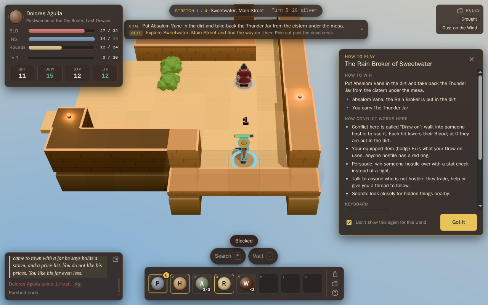
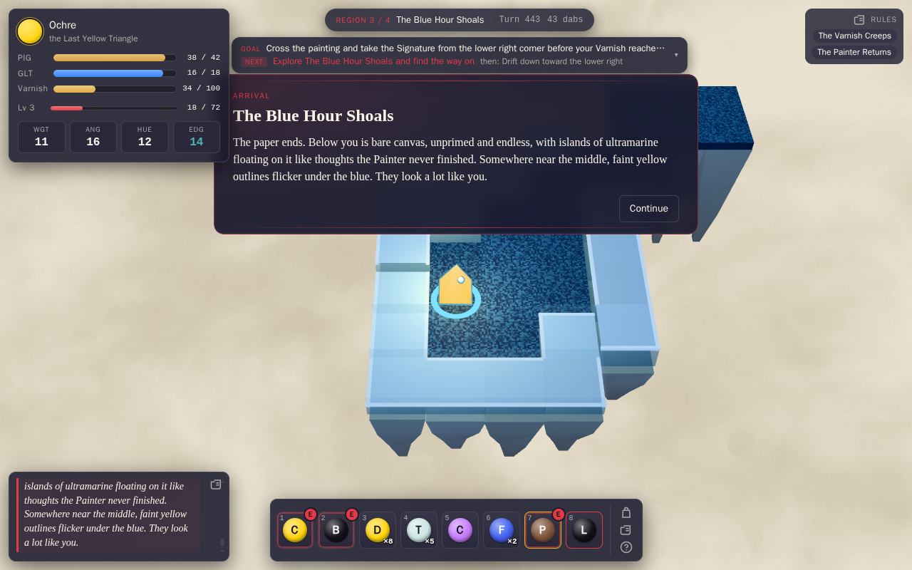
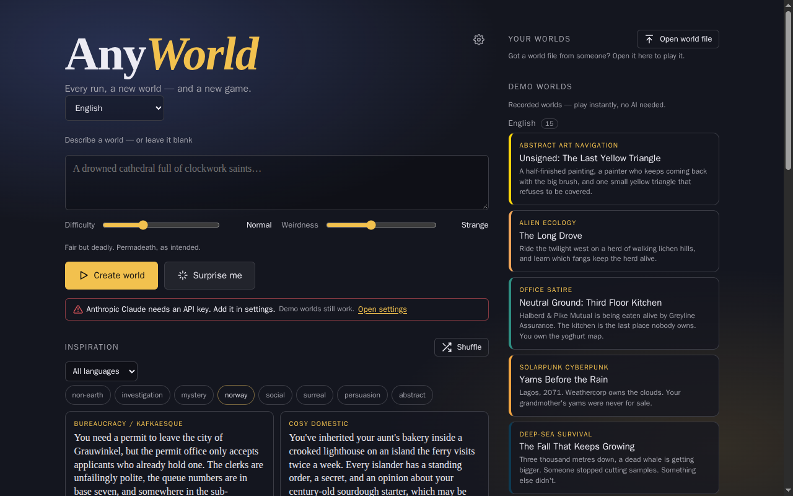
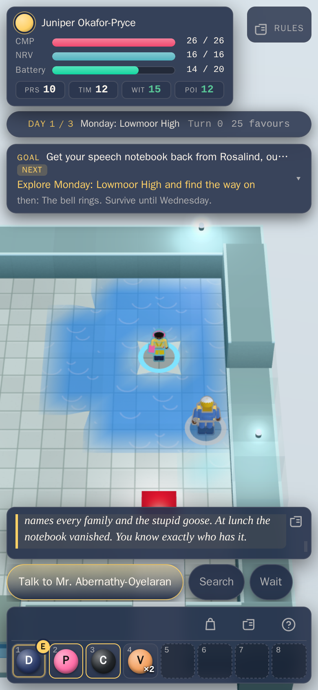

# AnyWorld

A turn-based roguelike where **every run is a different game**. At the start of a run an AI invents the
world: its genre, setting, characters, items, rules and goal. One run is a weird western, the next a
heist inside a string quartet, a week of teenage social survival, a Norwegian troll bureaucracy or a
yellow triangle crossing an unfinished painting. During play the same AI is a live game master that
narrates, voices characters and sometimes changes the rules. A deterministic engine keeps every world
playable and fair.

The AI writes only structured, validated data (a *World Spec*). It never writes code. Normal turns
never wait for the AI. With no AI at all, the 21 recorded demo worlds play with recorded narration.
Friends can also **play one run together** in a room: everyone moves at once, chats, and nobody waits.

Play it at **https://any-game.dv8.no** (the owner's server, with multiplayer rooms; creating new AI
worlds there needs an access code, the ready-made worlds are open to everyone).

> This repository is also an experiment: the game was designed with a human and then **built
> autonomously by Claude agents**. See [the experiment documents](#the-ai-experiment).

| | |
|---|---|
|  |  |
| *A weird western, with the per-world "how to play" card* | *An abstract world: you are a yellow triangle on a canvas* |
|  |  |
| *An earlier start screen (M4); today's is regrouped, see [The start page](#the-start-page)* | *Playing on a phone (390×844)* |

## Quick start

You need Node.js 22.23.4+, 24.22.1+ or 26.12.1+ (releases with the CVE-2026-111497 fix; see [docs/HOSTING.md](docs/HOSTING.md)).

```bash
npm install
npm run dev          # game + API server: open http://localhost:5173
```

Pick any ready-made world on the start page. No key is needed. To let the AI create new worlds, give the
server a key (see [Providers](#ai-providers)) and restart it:

```bash
ANTHROPIC_API_KEY=sk-ant-… npm run dev
```

### The two ways to run it

The same game build runs in two modes (DESIGN §4.4). In both, you play in a web browser.

| | Node backend | Browser-only (static) |
|---|---|---|
| Start | `npm run dev` (development) or `npm run build && npm start` (production, port 8787) | `npm run build:static`, then host `dist/static/` anywhere (GitHub Pages, any web server, a sub-folder). Try it locally with `npm run serve:static` (port 4173). |
| Who calls the LLM | The server (`POST /api/llm`). Keys live in the server's environment, and the browser never sees them. | The browser calls the provider directly. Enter a key in **Settings**. It is stored only in that browser's `localStorage`. |
| Providers | All presets | Only providers that allow browser (CORS) calls: Anthropic, OpenAI, OpenRouter, a local Ollama or LM Studio, or a custom endpoint that allows CORS |
| Best for | Sharing with others, and keeping keys safe | Hosting for free, or just trying it yourself |

**Direct mode warning:** in the static build the API key sits in the browser's `localStorage` and is
sent from the browser straight to the provider. Anyone with access to that browser profile can read it.
Use a key with a spending limit, or use the backend.

### Demo mode (no AI at all)

- **Ready-made (demo) worlds:** every recorded world (`content/worlds/`) plays at once, in both modes. The game
  master plays recorded lines (`content/recordings/`) and falls back to built-in lines.
- **Offline demo generator:** in **Settings → AI provider**, pick *Offline demo: recorded worlds, no AI*
  (the static build starts with it, so a first visit needs no key). "Create world" (under *Bring your
  own AI*) then picks the
  recorded world that best fits your prompt and runs it through the real pipeline (validation, bot
  play-test). This is useful for trying the whole flow without a key or a network. The copy is kept
  under "Your worlds" and labelled *recorded demo*, not *made by AI*.
- **"Surprise me" without a usable AI** (offline demo, or no key) plays a random recorded demo world in
  the current language. With a working provider it asks the AI for a new world as before.
- **Technical notes:** a short page for advanced users (`public/tech.html`, linked quietly at the bottom
  of the start page).
- **Turn off the AI game master** (Settings) to play an AI-made world without any AI calls during play.

When something is missing, the start page says so in one line: no key, a server that cannot be
reached, a server without a key for the chosen provider (with the variable to set), or a provider that
blocks browser calls. A failed world creation stays on the loading screen with the reason, a hint
(CORS, local server, timeout, key) and *Try again* / *Back*. A slow or failing AI never freezes a run.

Useful URLs: `/?world=<id>&seed=<n>` starts a recorded world directly (reloading resumes the run), and
`/?continue=1` resumes the saved run.

## AI providers

One setting picks the provider, and one picks the transport (direct or backend). Presets are in
`src/llm/presets.ts`. Any OpenAI-compatible endpoint can also be entered as **Custom**.

| Preset | Region | Server env var | Browser (direct) | Default model |
|---|---|---|---|---|
| Anthropic Claude (default) | US | `ANTHROPIC_API_KEY` | yes | `claude-opus-5-5` |
| OpenAI | US | `OPENAI_API_KEY` | yes | `gpt-5` |
| DeepSeek | China | `DEEPSEEK_API_KEY` | no, use the backend | `deepseek-chat` |
| Mistral | EU | `MISTRAL_API_KEY` | no, use the backend | `mistral-large-latest` |
| Qwen (Alibaba DashScope, compatible mode) | China | `DASHSCOPE_API_KEY` | no, use the backend | `qwen-plus` |
| Moonshot Kimi | China | `MOONSHOT_API_KEY` | no, use the backend | `kimi-k2-0905-preview` |
| Zhipu GLM | China | `ZHIPU_API_KEY` | no, use the backend | `glm-4.6` |
| OpenRouter (many models) | Global | `OPENROUTER_API_KEY` | yes | `deepseek/deepseek-chat-v3.1` |
| Ollama (local) | Local | `OLLAMA_BASE_URL` (e.g. `http://localhost:11434/v1`) | yes, with `OLLAMA_ORIGINS="*"` | `llama3.1` |
| LM Studio (local) | Local | `LMSTUDIO_BASE_URL` | yes, with CORS enabled in LM Studio | the loaded model |
| Custom (OpenAI-compatible) | — | `CUSTOM_LLM_BASE_URL`, `CUSTOM_LLM_API_KEY`, `CUSTOM_LLM_MODEL` | if the endpoint allows CORS | — |

More server settings: `<PRESET>_MODEL` overrides a preset's default model (e.g. `OLLAMA_MODEL`), and
`<PRESET>_MODELS` lists extra allowed models. There are also `PORT` (8787), `HOST`, `LLM_RATE_PER_MIN`,
`LLM_RATE_BURST`, `LLM_TIMEOUT_MS`, `LLM_TOTAL_TIMEOUT_MS`, `LLM_MAX_RETRIES`,
`LLM_MAX_OUTPUT_TOKENS`, `LLM_ALLOW_ANY_MODEL` and `TRUST_PROXY` (see `server/index.ts`). For
development, `ANYWORLD_CLIENT_PORT` changes the dev server's port (5173), and `PORT=0` gives the API a
free port.

Models differ in what structured output they support. A shared layer validates every answer against the
schema, repairs it with error feedback and retries. World creation also play-tests the world with bots
and rebalances it. Small local models often struggle to write a whole world.

### Hosting it yourself

To run the server on your own machine and reach it from the internet (systemd service, access code,
tunnels, pages hosted elsewhere), see [docs/HOSTING.md](docs/HOSTING.md). It also describes the setup
behind `any-game.dv8.no` (a home server on Ubuntu, reached over WireGuard through a VPS). The server needs a Node.js
release with the CVE-2026-111497 (HTTP2Shell) fix: 22.23.4+, 24.22.1+ or 26.12.1+.

### Firewall / allow-list

If you run AnyWorld behind an egress firewall (a sandbox, a company proxy), allow the hosts of the
providers you use. In backend mode the *server* needs them, and in direct mode the *browser* does:

`api.anthropic.com`, `api.openai.com`, `api.deepseek.com`, `api.mistral.ai`,
`dashscope-intl.aliyuncs.com`, `api.moonshot.ai`, `open.bigmodel.cn`, `openrouter.ai`.

The optional SoundCloud music (off by default) needs `soundcloud.com` and `w.soundcloud.com`. Demo mode
needs no network access beyond the game's own files.

## Playing

### The start page

One column, top to bottom:

- **What is AnyWorld?** A short intro in four points.
- **Continue**, when there is a saved run.
- **Featured worlds** (three Norwegian school worlds: *KKG: Talen*, *Kuben: Valget* and *Tangen:
  Lærlingplassen*), each with *Play alone* and *Play with friends*,
  next to **Play together** (marked *Multiplayer*): create a room or join one by code, and the list of
  open rooms with a count.
- **Ready-made worlds**, with a difficulty slider (Gentle to Brutal). Picking a card plays it alone; the
  people icon on each card opens it as a room instead. A legend over the list says which is which.
- **Your worlds**: AI-made and imported worlds kept in this browser, and *Open world file*.
- **Bring your own AI** (folded away at first): the world prompt, weirdness, the party option, *Create
  world*, *Surprise me*, the provider note and the inspiration cards. It needs an AI provider: your own
  key, or the server's access code. It opens by itself when your AI already works, and the browser
  remembers whether you left it open.

The language picker and the settings gear are at the top. Every button has a tooltip (hover or keyboard
focus); on touch, the labels and icons say what is solo and what is multiplayer.

### In a run

- **Goal:** each world defines its own win condition (defeat, escape, collect, solve, survive,
  persuade…), shown in the goal tracker at the top. Conflict can be a fight, an argument, an
  interrogation or a hack. The world names it, and the "how to play" card explains it.
- **Keyboard:** arrows / WASD / vi-keys move and attack, `1`–`8` use the quick slots, and single keys
  pick up, talk, search, wait and take the exit. `M` turns the sound on or off. `?` shows all keys.
- **Mouse:** click to walk or target, and hover to inspect.
- **Touch / mobile:** tap to walk, tap an adjacent character to act, long-press to inspect, and pinch to
  zoom. Context buttons (pick up, talk, exit, wait, search) appear when they are relevant. The layout
  is built for phones (iPhone 390×844, Pixel 412×915, portrait and landscape) as well as tablets and
  desktop.
- **Languages:** English and Norwegian bokmål. The picker is on the start screen and in Settings, and
  it defaults to the browser language. A world is written in one language (`meta.language`). Choosing
  an inspiration prompt in another language creates the world in that language. Adding a language
  means adding `src/client/i18n/<lang>.ts`, and a test fails on missing keys.
- **Hotbar buttons:** next to the quick slots, a speaker button turns the sound on or off (the same
  saved setting as `M` and Settings → Mute), a gear opens Settings, and `?` opens the help.
- **Audio:** generated music that follows the world's mood, plus sound effects. It starts on the first
  tap or key press. Settings has volume, mute, a *Music* switch (off keeps the sound effects) and
  optional SoundCloud. All of them are saved.
- **Settings** (the gear on the start page or the hotbar): provider, model, key and transport; server
  access code; AI game master on or off; audio; graphics quality (auto, low or high); animation speed;
  reduce motion; language.
- **Saves:** the run autosaves in the browser, and reloading the page continues it.
- **Back and Forward:** the browser's Back closes an open panel or dialog (settings, help, rules,
  backpack) first, then returns from a run, a room or a world being made to the start page; the run
  stays saved and Forward resumes it. Each screen has its own address (`?world=…&seed=…`, `?room=CODE`).

### Sharing worlds

AI-made worlds are kept in the browser and listed under **Your worlds** on the start screen. Each one
can be **saved as a file** (`<title>.anyworld.json`), and **Open world file** plays a world someone
sent you. Imported files are treated as untrusted: they are size-limited and re-validated (schema and
cross-references), and unknown fields are dropped. A world keeps its language. The format is
`{ "format": "anyworld-world", "version": 1, "world": <World Spec> }`, and a bare World Spec also
works. Share links and a gallery are possible later (DESIGN §12).

### Playing together

On a server with rooms (`npm run dev`, `npm start`, or the owner's server), **Play together** on the
start page creates a room for 2–12 players (8 by default) in a ready-made, imported or AI-made world.
Share the link (`…/?room=CODE`) or the QR code; open rooms are also listed on the start page. Players
pick a name and a colour, no accounts. Turns are simultaneous with a short deadline (1–5 s, chosen by
the host), so nobody waits. Chat shows as speech bubbles over the speaker, or in the side column when
they are out of view; phones get a chat button, emotes and map pings. Each player has their own second
chance on Gentle and Normal, and a downed player gets up when a teammate stands next to them. In a
room the game master runs on the server and may answer the chat (the lobby says so). A static build
has rooms only when it is built with `ANYWORLD_SERVER_URL` pointing at a server (docs/HOSTING.md §5).
Design and status: [docs/MULTIPLAYER-PLAN.md](docs/MULTIPLAYER-PLAN.md) and
[docs/progress/MP.md](docs/progress/MP.md).

### Privacy

- Saves, settings, kept worlds and (in direct mode) your API key stay in your browser's `localStorage`.
- AI calls go to the provider you picked, through the server or straight from the browser. In a room
  with the AI game master on, the room's chat goes to the server's provider too.
- **Page-view counts:** the public copies (`any-game.dv8.no`, `any.dv8.no`, `narve.github.io`) load
  the owner's [Umami](https://umami.is/) script from `m.dv8.no`, which counts page loads only: no
  cookies, no game events, no chat. The check is in `src/client/index.html`; a copy you run yourself
  (localhost, tests, your own host) never loads it.

## Development

```bash
npm run typecheck                 # tsc --noEmit
npm test                          # vitest (engine, schema, LLM contract tests with mocked HTTP, client, sims)
npm run e2e                       # Playwright, headed Chromium under xvfb (WebGL needs it)
xvfb-run -a npx playwright test e2e/modes.spec.ts   # static build, npm run dev and npm start, end to end
npm run validate-worlds           # every recorded world against the schema
npm run sim -- --seeds 100        # bot playthroughs: wins, deaths, stuck runs, crashes
```

Multiplayer browser specs live in `e2e-mp/` (`xvfb-run -a npx playwright test -c e2e-mp/playwright.mp.config.ts`).
e2e screenshots go to `test-results/shots/`. `SHOTS_TO_DOCS=1` writes them over the archived milestone
screenshots in `docs/archive/progress/` instead, so leave it unset. `MODES_PORT` moves `e2e/modes.spec.ts`
off its default port (5193).

### Project structure

```
src/
  schema/     zod contracts: World Spec, GM actions, prompt library, cross-reference validation
  engine/     the pure, deterministic rules: (state, action) → state. Map generators, combat, effects,
              inventory, knowledge, NPCs, GM actions, balance analysis, bots
  llm/        providers (Anthropic, OpenAI-compatible, mock), presets, transports (direct, backend),
              structured output (validate/repair/retry), prompts, world generation, GM runtime
  gm/         the game master's runner, offline lines, chat and voice, shared by browser and server
  net/        the room protocol and messages, engine version, the room client
  client/     the browser app (Vite root): main.ts (app shell), session.ts / game-controller.ts
              (engine ↔ renderer ↔ UI ↔ GM), render/ (three.js), ui/ (HTML overlay), room/ (lobby,
              room session, chat), audio/, i18n/ (catalogs), modes.ts (provider status, offline demo),
              world-file.ts (export/import), worlds.ts (bundled + kept worlds), storage.ts (saves, settings)
server/       Node backend: /api/llm proxy (keys from the env), /api/presets, /api/health, static files,
              rooms/ (WebSocket rooms, the rooms' game master, room files); dev.ts, serve-static.ts
content/      worlds/ (recorded World Specs), recordings/ (recorded GM/dialogue replies), prompts.json
              (the curated inspiration library)
tools/        sim, validate-worlds, print-prompt, agent-provider (agents acting as the LLM), room-bots,
              gm-smoke
deploy/       systemd unit and env example; scripts/deploy.sh updates a running server
tests/        vitest suites
e2e/, e2e-mp/ Playwright specs (single player, multiplayer)
docs/         HOSTING.md, MULTIPLAYER-PLAN.md, progress/ (multiplayer notes), playtest/, archive/
issues/       one file per bug found by tests, reviews and playtests
```

## The AI experiment

AnyWorld was built by Claude agents working autonomously in a sandbox. Parallel builders each owned
their own files, then reviewers, playtesters and fixers took over. No live LLM was used during the build.
Instead, agents *acted as the provider*: they got the game's exact prompts, and their answers were
validated, recorded and used to tune the prompts. That is where the demo worlds come from. The first
live API run is left to a human.

- [DESIGN.md](DESIGN.md): what the game is and why (agreed with the owner before the build)
- [PLAN.md](PLAN.md): architecture, milestones and backlogs
- [BUILD_LOG.md](BUILD_LOG.md): a chronological log of decisions, problems and fixes, per agent
- [issues/](issues/): every bug found, with its fix
- [docs/MULTIPLAYER-PLAN.md](docs/MULTIPLAYER-PLAN.md) and [docs/progress/](docs/progress/): the
  multiplayer edition (MP0–MP5), built the same way after v1
- [docs/archive/](docs/archive/): the v1 records, kept as written: milestone notes M1–M5 with
  screenshots, [STATS.md](docs/archive/STATS.md) (agents, time and tokens per phase) and
  [RETROSPECTIVE.md](docs/archive/RETROSPECTIVE.md) (what worked, what didn't, and what a human still
  has to check)

Known limits: real-device feel and frame rate on phones have been tested only in emulation, and live
LLM providers only in short smoke runs (about 30 Mistral Small game-master calls in MP4 and MP5); the
demo worlds and most tuning come from recorded or agent-written responses. A human has to confirm them.

## License

Copyright © 2026 Narve Sætre. AnyWorld is **source-available, not OSI open source**. Everything in this
repository (code, prompts and demo worlds) is licensed under the
[PolyForm Noncommercial License 1.0.0](LICENSE).

- **Allowed:** personal, hobby, study, research, education, and use by charities and public institutions.
  You can change the code and share it, as long as you include the license and the `Required Notice` line.
- **Not allowed without permission:** any commercial use, including running it as a paid or ad-funded service.

For a commercial license, contact the author through [GitHub](https://github.com/narve).
